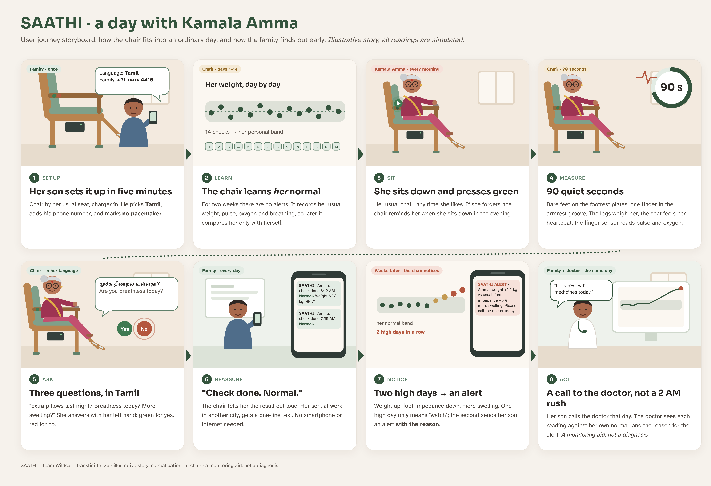

# SAATHI: a chair that warns of worsening heart failure

**Team Wildcat · Transfinitte '26 · NIT Trichy**

SAATHI ("Saathee", *companion*) is an ordinary armchair with a daily heart check built in. Once a day the patient
presses one button, sits still for 90 seconds and answers three spoken yes/no questions. The chair compares
the readings with **that person's own normal** and texts the family, with the reason, when the pattern starts
to look like worsening heart failure: often days before a hospital visit.


https://github.com/user-attachments/assets/e559d647-6299-4edf-a0c2-3a4cbf6d8adc


> **Simulation-first.** The software, firmware and both custom circuits are built and tested in simulation.
> No physical chair has been built and no real patient has been involved. SAATHI is a monitoring aid, not a
> medical diagnosis tool, and is not an emergency service.


---

## Headline results (simulation)

Results on a **locked test set of 200 new synthetic patients** (10,151 patient-days). The rules, seed and file
hashes were fixed before these patients were generated, and the set was scored exactly once.

| Measure | Result |
| --- | --- |
| Worsening events caught (sensitivity) | **80%** of 129 (95% CI 72–86%) |
| Normal days left alone (specificity) | **95.8%** |
| False alerts | **0.77** per 30 normal patient-days |
| Alerts that were real worsening (precision) | **40%** |
| Warning before admission | median **3 days** for caught events; 50% of all events warned ≥ 3 days ahead |
| Weight-only rule on the same patients | 23% caught |
| Parts cost (chair included) | **₹4,661** |

These numbers show how the method behaves on data we generated ourselves. They are **not clinical
evidence**. Full method, robustness tests and limits are in the [report](Deliverables/REPORT.pdf).

---

## How it works

| Signal | Sensor and position | Points weight |
| --- | --- | --- |
| Body weight | 4 load cells in the chair legs → HX711 | 1.0 |
| Foot bioimpedance (exploratory) | 50 kHz, 4 stainless plates on a fold-out footrest | 1.0 |
| Resting heart rate | PVDF film under the seat cushion (BCG) + MAX30102 in the armrest (PPG), fused | 0.7 |
| Breathing rate · SpO₂ (trend only) | MAX30102 | 0.7 · 0.5 |
| 3 symptom questions (Tamil / Hindi / English) | Speaker + green/red buttons | 0.7 per "yes" |
| Pulse transit time · chair use | BCG-to-PPG timing · sit-downs from the load cells | 0.25 each |

1. **Quality checks first.** If a sensor is missing, badly used or broken, the result is "no reading", never a
   made-up number.
2. **Personal baseline.** The first 14 days learn each person's normal (median and spread per signal).
3. **Daily score.** Points are given only when a signal moves beyond the person's normal spread, in the
   direction that means worsening.
4. **Alert.** Any one of these triggers an alert:
   - a high score on 2 measured days in a row;
   - weight up 2 kg in 3 days;
   - SpO₂ 4 or more points below the person's own normal, twice;
   - checks stopping for 2 days after a high score.

   Every alert says *why* ("weight +1.4 kg, foot impedance −5% vs usual").
5. **Delivery.** An ESP32 decides offline. Alerts wait in a flash outbox and go out by SMS (SIM800L) as soon as
   the network is available.



---

## Repository map

| Folder | What's inside |
| --- | --- |
| [`Deliverables/`](Deliverables) | `REPORT.pdf` (2-page report), `Block Diagram.png`, `Storyboard.png`, `BOM.csv` |
| [`Hardware/Chair_Firmware/`](Hardware/Chair_Firmware) | ESP32 firmware (Arduino): sensors, signal processing (`dsp.cpp`), detector (`detector.cpp`), SMS outbox, voice prompts, storage, safety |
| [`Hardware/Schematics/`](Hardware/Schematics) | System, seat BCG front-end and foot bioimpedance schematics |
| [`Hardware/Verification/`](Hardware/Verification) | Circuit simulation plots: BCG frequency response, transient, amplitude sweep; bioimpedance accuracy |
| [`Hardware/`](Hardware) | LTspice files (`FootBiSensor.asc`, `opamp_pvdf.asc`, `bcg_frontend_ltspice.cir`), `BOM_Saathi.csv`, `BENCH_TESTS.md` (tests for a physical build) |
| [`Hardware/Samples/`](Hardware/Samples) | LTspice screenshots of the foot-impedance and PVDF circuits |
| [`CAD/`](CAD) | 3D-printable parts (STL): load-cell leg cups and feet, footrest hinge clamps, finger cradle; print and assembly notes |
| [`Simulation/Wokwi/`](Simulation/Wokwi) | Same firmware in demo mode (simulated sensors, real buttons) for the Wokwi ESP32 simulator |
| [`Simulation/Demo_Scenario.mp4`](Simulation/Demo_Scenario.mp4) | 62-second end-to-end demo of one simulated patient |
| [`Dashboard/index.html`](Dashboard/index.html) | Offline dashboard with patient, family and doctor views (open in any browser) |
| [`Data Analysis/Data Files/`](Data%20Analysis/Data%20Files) | Synthetic data: `Measured Readings/` = development set (120 patients); `Generated Readings/` = locked test set (200 patients) |
| [`Data Analysis/builder scripts/`](Data%20Analysis/builder%20scripts) | Python: data generator, signal pipeline, detector, data validation, real-ECG heart-rate check |
| [`Verification/`](Verification) | Robustness, false-alert trade-off and real-signal (PhysioNet) check plots |
| [`REFERENCES.md`](REFERENCES.md) | Every scientific source, what it contributed and where it is used |

### Data files (both sets are synthetic)

| File | One row per | Contents |
| --- | --- | --- |
| `patients.csv` | patient | age, sex, event type, admission day, warning window, implant flag |
| `daily.csv` | patient-day | true underlying values before measurement |
| `measured.csv` | patient-day | what the chair reported after signal processing (gaps where a check failed) |
| `truth.csv` | patient-day | whether the day was inside a worsening window, plus look-alike events (festival meal, fever, diuretic change…) |
| `alerts.csv` | patient-day | detector score, alert, rule fired, reason, day status |
| `detector_params.json` | — | threshold (1.25), time-of-day weight correction, train/test patient split |

---

## Try it

**Dashboard:** download `Dashboard/index.html` and open it in a browser. No install or internet needed
(only the web fonts need internet). All data shown is simulated.

**Firmware in the browser:** open the [Wokwi project](https://wokwi.com/projects/478814715951206401). In the
serial monitor (115200) type `demo-days 19`, then press **GREEN** each "day" and answer the questions. From
day 20 the simulated patient retains fluid and the chair moves from NORMAL → WATCH → ALERT, printing the reason
and the SMS. Details: [`Simulation/Wokwi/README.md`](Simulation/Wokwi/README.md).

**Firmware on hardware:** open `Hardware/Chair_Firmware/saathi_chair.ino` in Arduino IDE (ESP32 core 3.x).
Pins and thresholds are in `config.h`.

**Python scripts** (Python 3.10+):

```bash
pip install numpy pandas scipy matplotlib wfdb
cd "Data Analysis/builder scripts"
mkdir -p data reports
python generate_data.py          # synthetic patients  → data/
python validate_data.py          # realism checks      → reports/
python bidmc_hr_check.py --selftest   # offline check of the heart-rate code
python bidmc_hr_check.py         # real heart-failure ECGs from PhysioNet (needs internet)
```

**3D parts:** see [`CAD/README.md`](CAD/README.md). Print in PETG (PLA creeps under constant load and drifts
the weight reading).

---

## Bill of materials (summary)

| Block | Main parts | ₹ |
| --- | --- | --- |
| Chair | Nilkamal plastic armchair | 1,040 |
| Controller | ESP32 dev board | 499 |
| Weight | 4 × 50 kg load cells + HX711 | 215 |
| Heart / oxygen / breathing | MAX30102 | 112 |
| Seat BCG | PVDF film + MCP6004 op-amp | 686 |
| Foot impedance | MCP6024, CD4066, steel plates, safety parts | 417 |
| Voice | PAM8403 amplifier + speaker | 42 |
| SMS | SIM800L | 364 |
| Power | 2 × 18650, TP4056, MT3608, holder | 511 |
| Buttons, passives, footrest, printed parts | | 775 |
| **Total** | | **₹4,661** |

Full list with vendors and links: [`Deliverables/BOM.csv`](Deliverables/BOM.csv). Prices are from Indian online
stores (Oct 2026); lines marked "estimate" are not from a listed price.

---

## Limits (stated plainly)

- **Not clinical evidence.** We wrote the data and the detector, and real patients will differ.
- **No physical chair yet.** Weight accuracy, the real seat signal, battery life and usability are unmeasured.
  [`Hardware/BENCH_TESTS.md`](Hardware/BENCH_TESTS.md) lists the tests a build must pass.
- **Many false alarms and short warning.** Only 40% of alerts are real, half of events get 3+ days of
  warning, and subtle worsening is mostly missed (36%).
- **Weak signals.** Breathing rate from the finger sensor is weak, SpO₂ is used as a trend only, and foot
  impedance is unproven (adapted from implanted chest-impedance studies). As a precaution, foot impedance is
  switched off for patients with a pacemaker or other implant.
- **Not yet reviewed.** The Tamil and Hindi voice prompts still need review by native speakers.
- **Next steps:** a bench build, then the BIDMC heart-failure recordings, then a small pilot, only with ethics
  approval.

## Key references

1. Chaudhry SI et al. Patterns of weight change preceding hospitalization for heart failure. *Circulation* 2007.
2. Yu CM et al. Intrathoracic impedance monitoring in patients with heart failure. *Circulation* 2005.
3. Inan OT et al. Novel wearable seismocardiography and machine learning algorithms… *Circ Heart Fail* 2018.
4. Stehlik J et al. Continuous wearable monitoring analytics predict heart failure hospitalization (LINK-HF).
   *Circ Heart Fail* 2020.

Complete list with what each source contributed: [`REFERENCES.md`](REFERENCES.md).

---

*Team Wildcat, RMI club, NIT Trichy. SAATHI is a monitoring aid, not a diagnosis.*
